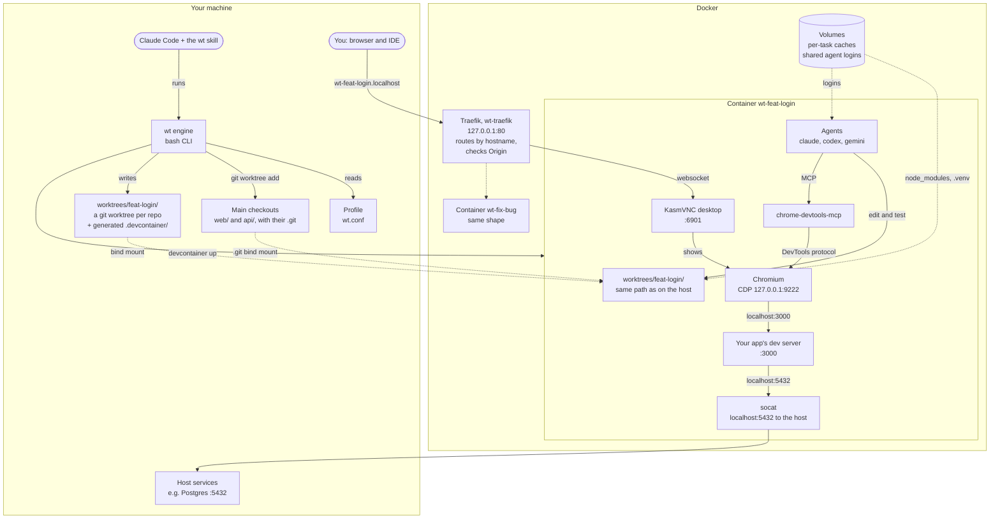
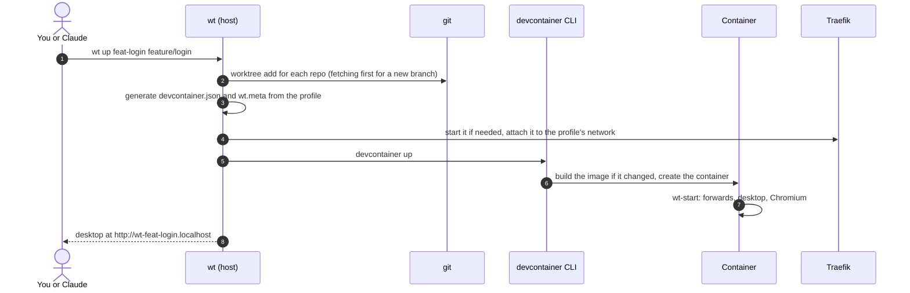

# Worktree Devcontainers: why, what and how

A dev container per git worktree, each with its own desktop and Chromium, so several coding agents,
or an agent and you, can work on the same repos at the same time. It ships as `wt`, a small bash
engine, and as a Claude Code and Cursor plugin whose skill sets the engine up and runs it for you.

Author: [jackni](https://github.com/jackni) ·
Source: [github.com/jackni/worktree-devcontainer-setup](https://github.com/jackni/worktree-devcontainer-setup)

## Why: the problem

Coding agents are fast enough that the bottleneck is how many tasks run at once. Running two or more
on one codebase breaks down quickly:

- **One checkout, one branch.** Two agents in the same folder overwrite each other's edits. Git
  worktrees give each task its own files and branch, but nothing else.
- **Shared packages.** Worktrees of one repo still install into folders that look the same. One
  branch's dependency upgrade breaks the other's install, and two installs at once corrupt each other.
- **Port clashes.** Every task wants to run the dev server, and they all want `:3000` or `:5173`.
- **One browser.** An agent that checks its work in a browser needs one of its own. Sharing yours
  mixes logins, tabs and cookies, and two agents can't drive one browser at once.
- **Setup per task.** A dev container per worktree solves most of this, but writing one by hand
  for every task, across several repos, caches and agents, is slow. `devcontainer.json` has no
  loops, so it can't be written once and reused.
- **Tools on the host.** Without containers, every project's language versions and tools pile up
  on your machine and drift apart between projects.

## What: one command per task

```bash
wt up feat-login feature/login
```

That gives the task `feat-login`:

- **A git worktree of every repo** in your project, on its branch. A branch that exists only on the
  remote is checked out tracking it, so you test your colleague's code rather than an empty branch.
- **Its own container,** with the project's packages, tools and ports. Dev servers in two tasks can
  both use `:3000`.
- **Its own desktop and Chromium** at `http://wt-feat-login.localhost`. You click through the app
  there, and agents drive the same Chromium over MCP.
- **The agents you use** (Claude Code, Codex, Gemini, or your own) installed in the image. Logins
  live on a shared volume, so you log in once for every task.
- **Your IDE in the container.** VS Code or Cursor opens the worktree folder in the same container,
  with IntelliSense and debugging working against the container's packages.

`wt down feat-login` removes the container, its volumes and the folder. It refuses when that would
lose work: uncommitted changes, or ignored files such as `.env` that exist nowhere else.

Everything project-specific lives in a **profile** (`wt.conf`): the repos, base image, cache
folders, host ports and agents. The engine knows no project, so one engine serves any stack.

The **Claude Code and Cursor plugin** adds a skill that does the setup when you ask in plain
words, e.g. "set up wt so I can run two agents on web and api in parallel". It checks the host,
copies the engine into your workspace, drafts the profile from what your repos contain, and runs
`wt`.

### What it is not

- **Not a security sandbox.** The container isolates packages, ports and processes, not your
  machine. Code inside it can get code run on the host, through the main checkouts' `.git`, files in
  the worktree folder and the workspace's agent files. Run in it only agents and code you would run
  on the host. The README's
  [What the container isolates](../README.md#what-the-container-isolates) lists each route.
- **Not a cloud service.** Everything runs on your machine, in Docker.
- **Not CI.** Keep the full test suite and builds in CI; worktree git hooks should stay fast.

## How it works

### Architecture



Solid arrows are what happens at run time; dotted ones are how the container sees files and how
Traefik reaches the other tasks' desktops.

### The parts

| Part | Where it runs | What it does |
| --- | --- | --- |
| `wt` | Host | Creates the worktrees, generates each `devcontainer.json` from the profile, starts and removes containers, and refuses removals that would lose work |
| Profile (`wt.conf`) | Host | Everything that differs per project; `profiles/example/wt.conf` documents every setting |
| `Dockerfile` | Image build | Desktop, Chromium, `chrome-devtools-mcp`, Node, then the profile's setup and the agents' installs as the last layers |
| `wt-start` | Container, on every start | Starts the desktop, Chromium and the port forwards, hands volume mount points to the user, runs the profile's hooks |
| Traefik | Docker, one per machine | Routes `wt-<name>.localhost` to that container's desktop, on loopback only |
| `husky-init.sh` | Host, inside git hooks | Runs a worktree's husky hooks in its container, where `node_modules` lives |
| The `wt` skill | Claude Code or Cursor | Checks the host, installs the engine into your workspace, drafts the profile, runs `wt` |

### What `wt up` does



### Design decisions

- **Generated `devcontainer.json`.** The number of repos, caches and agents varies per profile, and
  the format has no loops, so `wt` writes each worktree's file. The file's hash labels the
  container, so `wt start` notices a profile change and recreates the container, keeping its volumes.
- **Caches on volumes, not on the shared folder.** On macOS and Windows a bind-mounted
  `node_modules` is slow, and Linux-built binaries in it break tools on the host. Each task gets its
  own volume, named after its folder so two workspaces never share or delete each other's.
- **One login per agent.** Each agent's home folder is a volume every task shares, so you log in
  once.
- **Routing by hostname, loopback only.** Browsers resolve every `*.localhost` name to your machine,
  so Traefik routes by name and no ports are published per task. KasmVNC has no login and only checks
  that an Origin header exists, so the route refuses websocket upgrades from any page but the
  desktop's own.
- **Shared host services through socat.** The app in the container dials `localhost:5432` as on
  your machine, and socat forwards it through the Docker network's gateway. An opt-in isolated mode
  lets a profile run per-task databases instead.
- **Hooks run where the packages are.** A commit from the host in a husky repo runs its hooks in the
  task's container, so lint and tests use the container's `node_modules`.
- **The engine is copied into your workspace.** `wt` finds everything next to itself, and a plugin's
  folder moves on every update, so the skill installs the engine beside your repos and keeps your
  profile outside it.

### Trade-offs

- Each task costs a container's memory and CPU while it runs. Closing the IDE stops the container,
  and `wt start` brings it back.
- The first `wt up` builds the image, which takes several minutes. Later ones reuse the build cache.
- Cache folders are visible only inside the container. Run agents and the IDE there.
- Supported hosts: macOS and Linux, and Windows through WSL 2, with Docker and the devcontainer CLI.

## Getting it

In Claude Code:

```bash
claude plugin install worktree-devcontainers --marketplace jackni/worktree-devcontainer-setup
```

In Cursor, the same repo is a Cursor plugin; the README's "Or let Cursor set it up" covers the
install. Then ask the agent to set it up. Without either, follow
[GETTING-STARTED.md](../GETTING-STARTED.md); the [README](../README.md) covers every command and
setting.
